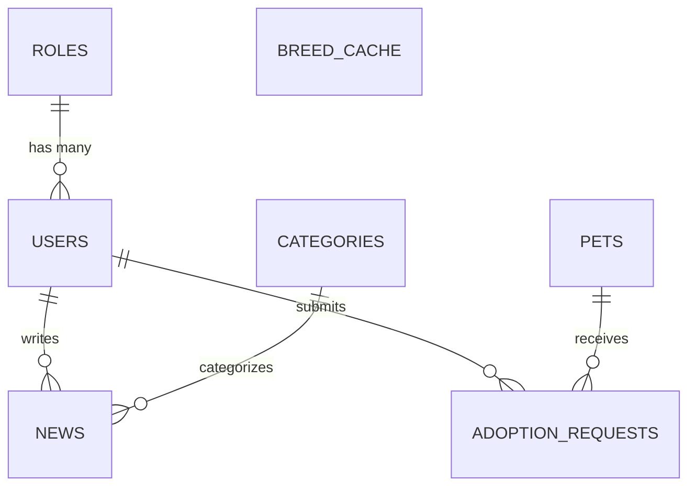

# 🐾 PawSafe — Explicação Completa da Arquitetura e Código-Fonte

Este documento fornece uma explicação detalhada e estruturada de todo o código-fonte da aplicação **PawSafe**, uma plataforma web desenvolvida em **Laravel** dedicada à gestão de abrigos de animais, processos de adoção responsável e publicação de notícias/campanhas de sensibilização.

---

## 📑 Índice
1. [Visão Geral & Stack Tecnológica](#1-visão-geral--stack-tecnológica)
2. [Estrutura Global do Projeto](#2-estrutura-global-do-projeto)
3. [Base de Dados & Modelos Eloquent](#3-base-de-dados--modelos-eloquent)
4. [Camada de Serviços (Services) & APIs Externas](#4-camada-de-serviços-services--apis-externas)
5. [Autenticação, Autorização e Middleware (RBAC)](#5-autenticação-autorização-e-middleware-rbac)
6. [Controladores (Controllers) & Lógica de Negócio](#6-controladores-controllers--lógica-de-negócio)
7. [API RESTful (v1)](#7-api-restful-v1)
8. [Rotas do Sistema (Routes)](#8-rotas-do-sistema-routes)
9. [Interface do Utilizador (Views Blade & Layouts)](#9-interface-do-utilizador-views-blade--layouts)
10. [Testes Automatizados](#10-testes-automatizados)
11. [Guia de Execução & Comandos Artisan](#11-guia-de-execução--comandos-artisan)

---

## 1. Visão Geral & Stack Tecnológica

O **PawSafe** é uma aplicação completa com:
- **Área Pública**: Catálogo de animais com filtros avançados, fichas detalhadas de raça com dados de APIs externas, submissão de pedidos de adoção, artigos de notícias e área de perfil.
- **Painel Administrativo (`/admin`)**: Dashboard com métricas em tempo real, gestão de animais (CRUD completo e histórico), aprovação/rejeição de pedidos de adoção, gestão de notícias, gestão de categorias e gestão de utilizadores e permissões.
- **API RESTful (`/api/v1`)**: Endpoints documentados com JSON Schema para integração externa.

### Tecnologias:
- **Backend**: PHP 8.2+ e Framework Laravel (arquitetura MVC com camada de Serviços).
- **Frontend**: Blade Templating Engine com CSS personalizado moderno, responsivo e transições suaves.
- **Base de Dados**: Suporta SQLite (desenvolvimento ágil) e MySQL/PostgreSQL.
- **APIs Externas Integradas**:
  - `TheDogAPI` & `TheCatAPI`: Imagens e especificações de raças em tempo real.
  - `Pexels API` & `Unsplash`: Obtenção dinâmica de imagens contextuais para notícias.
- **Cache**: Laravel Cache (armazenamento de chamadas a APIs para performance e tolerância a falhas).

---

## 2. Estrutura Global do Projeto

```
NTPWS-26_27/
├── app/
│   ├── Http/
│   │   ├── Controllers/
│   │   │   ├── Admin/           # Controladores do Painel de Administração
│   │   │   │   ├── AdminCategoryController.php
│   │   │   │   ├── AdminNewsController.php
│   │   │   │   ├── AdminPetController.php
│   │   │   │   ├── AdminUserController.php
│   │   │   │   └── DashboardController.php
│   │   │   ├── Api/             # Endpoints RESTful versionados
│   │   │   │   └── ApiNewsController.php
│   │   │   ├── Auth/            # Registo, Login e Logout
│   │   │   │   └── AuthController.php
│   │   │   ├── HomeController.php
│   │   │   ├── NewsController.php
│   │   │   ├── PetController.php
│   │   │   └── ProfileController.php
│   │   └── Middleware/          # Proteção e controlo de acessos
│   │       ├── CheckActiveUser.php
│   │       └── CheckRole.php
│   ├── Models/                  # Modelos Eloquent e regras relacionais
│   │   ├── AdoptionRequest.php
│   │   ├── BreedCache.php
│   │   ├── Category.php
│   │   ├── News.php
│   │   ├── Pet.php
│   │   ├── Role.php
│   │   └── User.php
│   └── Services/                # Lógica externa isolada (APIs e Cache)
│       ├── BreedService.php
│       ├── NewsImageService.php
│       └── PetImageService.php
├── bootstrap/                   # Inicialização da aplicação e registo de middlewares
│   └── app.php
├── config/                      # Configurações (ex: services.php com chaves de API)
├── database/
│   ├── migrations/              # Estrutura e schema das tabelas
│   └── seeders/                 # Povoamento inicial da BD (DatabaseSeeder.php)
├── public/                      # Ficheiros estáticos e schemas JSON
│   └── schemas/
│       └── news-schema.json
├── resources/
│   └── views/                   # Vistas Blade (HTML dinâmico)
│       ├── admin/               # Vistas do painel administrativo
│       ├── auth/                # Formulários de autenticação
│       ├── layouts/             # Layouts mestres (app.blade.php e admin.blade.php)
│       └── public/              # Páginas públicas (home, pets, news, perfil)
├── routes/
│   ├── api.php                  # Rotas da API REST
│   └── web.php                  # Rotas web (públicas, utilizador e admin)
└── tests/                       # Testes de integração e feature
```

---

## 3. Base de Dados & Modelos Eloquent

### 3.1. Diagrama de Relações



### 3.2. Detalhe dos Modelos (`app/Models/`)

#### 1. `Role` (`app/Models/Role.php`)
- **Tabela**: `roles`
- **Campos**: `id`, `name` (`admin`, `editor`, `user`), `description`, `timestamps`.
- **Constantes**: `Role::ADMIN`, `Role::EDITOR`, `Role::USER`.
- **Relação**: `hasMany(User::class)` — um cargo tem múltiplos utilizadores.

#### 2. `User` (`app/Models/User.php`)
- **Tabela**: `users`
- **Campos**: `id`, `name`, `email`, `password`, `phone`, `avatar_path`, `role_id`, `is_active`, `timestamps`.
- **Relações**:
  - `belongsTo(Role::class)`: Cargo atribuído.
  - `hasMany(News::class, 'author_id')`: Notícias da autoria do utilizador.
  - `hasMany(AdoptionRequest::class)`: Pedidos de adoção efetuados.
- **Métodos Auxiliares**: `isAdmin()`, `isEditor()`, `isEditorOrAbove()`, `isActive()`.

#### 3. `Category` (`app/Models/Category.php`)
- **Tabela**: `categories`
- **Campos**: `id`, `name`, `slug`, `description`, `timestamps`.
- **Funcionalidade Especial**: No evento Eloquent `boot()`, gera automaticamente o `slug` a partir do `name` (ex.: "Histórias de Sucesso" vira `historias-de-sucesso`).
- **Relação**: `hasMany(News::class)`: Notícias associadas.

#### 4. `News` (`app/Models/News.php`)
- **Tabela**: `news`
- **Campos**: `id`, `title`, `slug`, `summary`, `content`, `category_id`, `author_id`, `image_path`, `status` (`draft`, `published`), `published_at`, `timestamps`.
- **Scopes Úteis**: `scopePublished($query)` e `scopeDraft($query)`.
- **Accessor Dinâmico (`getImageUrlAttribute`)**:
  - Se tiver imagem carregada localmente ou URL direto, utiliza-a.
  - Se não tiver imagem, invoca o `NewsImageService` para ir buscar uma fotografia de alta resolução à API externa de forma contextual.

#### 5. `Pet` (`app/Models/Pet.php`)
- **Tabela**: `pets`
- **Campos**: `id`, `name`, `species` (`dog`, `cat`, `other`), `breed`, `age_years`, `age_months`, `gender` (`male`, `female`), `size` (`small`, `medium`, `large`), `description`, `image_path`, `status` (`available`, `pending`, `adopted`), `timestamps`.
- **Accessor Dinâmico (`getImageUrlAttribute`)**:
  - Se tiver imagem própria carregada, utiliza-a via `Storage::url()`.
  - Caso contrário, chama o `PetImageService` para obter da API externa uma foto única condizente com a espécie e raça do animal.
- **Relação**: `hasMany(AdoptionRequest::class)`.
- **Scopes**: `scopeAvailable($query)`.

#### 6. `AdoptionRequest` (`app/Models/AdoptionRequest.php`)
- **Tabela**: `adoption_requests`
- **Campos**: `id`, `pet_id`, `user_id`, `message`, `status` (`pending`, `approved`, `rejected`), `admin_notes`, `timestamps`.
- **Relações**: `belongsTo(Pet::class)` e `belongsTo(User::class)`.
- **Métodos**: `isPending()`, `isApproved()`.

#### 7. `BreedCache` (`app/Models/BreedCache.php`)
- **Tabela**: `breed_cache`
- **Campos**: `id`, `species`, `breed_name`, `data_json`, `image_url`, `fetched_at`, `timestamps`.
- **Objetivo**: Armazenar na base de dados as respostas de raças vindas da API externa para evitar requisições repetidas e lentidão.
- **Método**: `isStale()` (avalia se o registo tem mais de 24 horas).

---

## 4. Camada de Serviços (Services) & APIs Externas

Em vez de sobrecarregar os controladores, as integrações com serviços de terceiros foram desacopladas na pasta `app/Services/`:

### 4.1. `PetImageService` (`app/Services/PetImageService.php`)
- **Objetivo**: Garantir que cada animal sem fotografia própria tenha uma imagem única, bonita e apropriada à sua espécie e raça.
- **Como funciona**:
  1. Verifica a cache (`pet_image_{petId}_{species}_{hash}`).
  2. Liga-se a **TheDogAPI** (`api.thedogapi.com`) para cães ou **TheCatAPI** (`api.thecatapi.com`) para gatos.
  3. Faz correspondência com o nome da raça para obter fotos específicas daquela raça.
  4. Se a API externa falhar ou atingir o limite, recorre a uma lista de fallbacks determinísticos baseados no ID do animal para evitar repetições.
  5. As imagens obtidas são mantidas em cache durante 7 dias.

### 4.2. `NewsImageService` (`app/Services/NewsImageService.php`)
- **Objetivo**: Prover fotografias profissionais para artigos de notícias que não possuem imagem manual.
- **Como funciona**:
  1. Consulta a cache (`news_image_{articleId}`).
  2. Mapeia categorias para termos de pesquisa temáticos (ex: `adoption-stories` -> *"happy pet family adoption"*, `health-care` -> *"veterinary pet health care"*).
  3. Caso a chave `PEXELS_API_KEY` esteja configurada, pesquisa na **Pexels API** (`api.pexels.com/v1/search`).
  4. Em caso de ausência de chave ou falha de rede, recorre a fotos curadas temáticas por categoria.
  5. Cache de 7 dias para máxima rapidez.

### 4.3. `BreedService` (`app/Services/BreedService.php`)
- **Objetivo**: Obter a ficha biográfica e características da raça de cão ou gato (temperamento, esperança média de vida, grupo, peso, etc.).
- **Como funciona**:
  1. Consulta primeiro a tabela `breed_cache`.
  2. Se os dados tiverem menos de 24 horas, devolve-os de imediato (`source: cache`).
  3. Se estiverem desatualizados ou não existirem, faz um pedido HTTP às APIs `TheDogAPI` / `TheCatAPI`.
  4. Salva ou atualiza os dados em `breed_cache` e devolve ao controlador (`source: api`).

---

## 5. Autenticação, Autorização e Middleware (RBAC)

O sistema implementa **Role-Based Access Control (RBAC)** rigoroso:

### Níveis de Acesso:
1. **Visitante (Guest)**: Navega pelos animais, lê notícias, vê a página "Sobre", regista-se ou faz login.
2. **Utilizador Registado (`user`)**: Tudo o anterior + submete pedidos de adoção para animais disponíveis e edita o seu perfil e palavra-passe.
3. **Editor (`editor`)**: Tem acesso ao Painel de Administração para criar, editar e gerir notícias.
4. **Administrador (`admin`)**: Controlo total do sistema:
   - Gestão de Animais e decisão de Pedidos de Adoção;
   - Gestão de Notícias e Categorias;
   - Gestão de Utilizadores (alteração de papéis e ativação/desativação de contas).

### Middlewares:
- **`CheckRole` (`app/Http/Middleware/CheckRole.php`)**:
  - Aceita uma lista de roles autorizados: `middleware('role:admin,editor')`.
  - Se o utilizador não tiver permissão, responde com `403 Forbidden`.
- **`CheckActiveUser` (`app/Http/Middleware/CheckActiveUser.php`)**:
  - Injetado globalmente no grupo `web`.
  - Caso um utilizador esteja autenticado mas tenha `is_active = false`, a sessão é imediatamente terminada e o utilizador é redirecionado para o login com aviso de conta inativa.

---

## 6. Controladores (Controllers) & Lógica de Negócio

### 6.1. Área Pública
- **`HomeController`**: Apresenta a página inicial com estatísticas do abrigo, animais em destaque para adoção e notícias recentes. Fornece também a página "Sobre".
- **`PetController`**:
  - `index`: Pesquisa por texto e filtros combinados (espécie, tamanho, género) com paginação.
  - `show`: Mostra detalhes do animal, ficha de raça (via `BreedService`) e formulário de pedido de adoção (se autenticado).
  - `submitAdoption`: Valida e impede candidaturas duplicadas pelo mesmo utilizador.
- **`NewsController`**:
  - `index`: Listagem com pesquisa e filtro por categoria.
  - `show`: Leitura do artigo completo com listagem de artigos relacionados.
- **`ProfileController`**:
  - Permite aos utilizadores autenticados atualizar o seu nome, telefone e alterar a palavra-passe em segurança.
- **`AuthController`**:
  - Registo com hashing seguro `bcrypt` e atribuição automática do cargo `user`.
  - Login com proteção de regeneração de sessão contra ataques de *session fixation*.
  - Logout com invalidação de sessão e token CSRF.

### 6.2. Painel de Administração (`app/Http/Controllers/Admin/`)
- **`DashboardController`**:
  - Agrega métricas cruciais: total de animais, animais adotados, pedidos de adoção pendentes, total de notícias e utilizadores ativos.
  - Mostra listas rápidas dos pedidos e notícias mais recentes.
- **`AdminPetController`**:
  - CRUD completo de animais (nome, espécie, raça, idade, género, porte, estado, upload de fotografia para `storage/app/public/pets`).
  - `updateAdoptionRequest`: Permite aprovar (`approved`) ou rejeitar (`rejected`) pedidos de adoção. Ao aprovar um pedido, pode alterar automaticamente o estado do animal para `adopted`.
- **`AdminNewsController`**:
  - CRUD de notícias com suporte a rascunhos (`draft`), publicação com agendamento/data (`published`), upload de imagens para `storage/app/public/news` e atribuição de categorias.
- **`AdminCategoryController`**:
  - Criação, edição e remoção de categorias de notícias com validação de unicidade de slugs.
- **`AdminUserController`**:
  - Listagem com filtro por cargo e pesquisa.
  - Edição do cargo do utilizador (`admin`, `editor`, `user`) e estado ativo/inativo. Ao desativar, limpa as sessões ativas do utilizador na base de dados.

---

## 7. API RESTful (v1)

A aplicação expõe uma API REST moderna em `/api/v1` (`app/Http/Controllers/Api/ApiNewsController.php`):

| Método | Endpoint | Proteção | Descrição |
|---|---|---|---|
| `GET` | `/api/v1/news` | Pública | Lista notícias publicadas (com paginação e filtros) |
| `GET` | `/api/v1/news/{id}` | Pública | Detalhe de uma notícia publicada |
| `GET` | `/api/v1/categories` | Pública | Lista de categorias ativas |
| `GET` | `/api/v1/schema` | Pública | Devolve o JSON Schema oficial das notícias |
| `POST` | `/api/v1/news` | Sanctum (`editor/admin`) | Criação programática de notícia |
| `PATCH` | `/api/v1/news/{id}` | Sanctum (`editor/admin`) | Atualização parcial de notícia |
| `DELETE` | `/api/v1/news/{id}` | Sanctum (`editor/admin`) | Remoção de notícia |

As respostas JSON seguem o formato padronizado com blocos `data` e `meta`.

---

## 8. Rotas do Sistema (Routes)

As rotas estão declaradas em dois ficheiros:

1. **`routes/web.php`**:
   - Rotas públicas: `/`, `/about`, `/news`, `/news/{slug}`, `/pets`, `/pets/{pet}`.
   - Rotas de convidados (`middleware('guest')`): `/login`, `/register`.
   - Rotas de utilizadores autenticados (`middleware('auth')`): `/profile`, `/pets/{pet}/adopt`, `/logout`.
   - Rotas de administração (`prefix('admin')->middleware(['auth', 'role:admin,editor'])`):
     - Dashboard: `/admin`
     - Gestão de Notícias: `/admin/news` (admins e editores)
     - Gestão de Categorias, Animais, Adoções e Utilizadores (apenas admins).

2. **`routes/api.php`**:
   - Endpoints `/api/v1/*` com rotas públicas e rotas protegidas por token `auth:sanctum`.

---

## 9. Interface do Utilizador (Views Blade & Layouts)

### Layouts Principais:
- **`resources/views/layouts/app.blade.php`**:
  - Layout público com barra de navegação responsiva, estado de sessão do utilizador, mensagens flash de sucesso/erro e rodapé completo.
- **`resources/views/layouts/admin.blade.php`**:
  - Layout do painel de administração com barra lateral (sidebar), indicadores de utilizador com cargo em destaque e navegação dedicada.

### Destaques Visuais e de Usabilidade:
- Sistema de cores semântico e harmónico (tons acolhedores de abrigo animal, contrastes acessíveis).
- Cartões dinâmicos com badges de estado (ex: "Disponível", "Adotado", "Pendente", "Publicado", "Rascunho").
- Formulários com validação visual imediata e preservação de campos (`old()`).

---

## 10. Testes Automatizados

O projeto inclui testes de funcionalidade automatizados em `tests/Feature/PawSafePagesTest.php`, cobrindo:
- Carregamento da página inicial (`/`);
- Página "Sobre" (`/about`);
- Listagem e detalhe de notícias (`/news` e `/news/{slug}`);
- Listagem de animais (`/pets`);
- Respostas JSON da API `/api/v1/news`;
- Conformidade do endpoint `/api/v1/schema`.

Para executar a suite de testes:
```bash
php artisan test
```

---

## 11. Guia de Execução & Comandos Artisan

### Configuração Inicial (.env):
Certifique-se de que o ficheiro `.env` contém as chaves para os serviços externos (opcionais, com fallback automático):
```env
DOG_API_KEY=
CAT_API_KEY=
PEXELS_API_KEY=
```

### Comandos Essenciais:
```bash
# Instalar dependências PHP
composer install

# Criar a chave da aplicação
php artisan key:generate

# Criar link simbólico para imagens enviadas
php artisan storage:link

# Executar migrações e popular com dados de teste
php artisan migrate --seed

# Iniciar o servidor local
php artisan serve
```

### Contas de Teste Pré-configuradas (via Seeder):
- **Administrador**: `admin@pawsafe.org` / `password`
- **Editor**: `editor@pawsafe.org` / `password`
- **Utilizador**: `user@pawsafe.org` / `password`

---

*Ficheiro gerado para documentação técnica completa do projeto PawSafe.*
